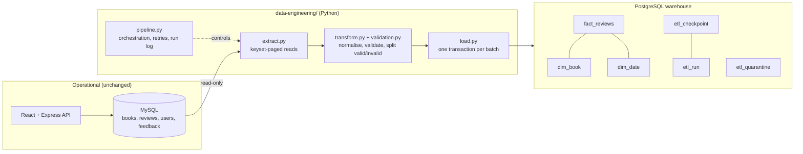

# Reading Radical - data engineering module

A separate Python ETL pipeline that copies book and review data from the **operational MySQL database** into an
**analytical PostgreSQL warehouse** (star schema), incrementally and idempotently, with data-quality validation
and a quarantine for rejected records.

The Express/React application does not depend on this module at all - if the pipeline is not running, the
website works exactly as before. The pipeline only *reads* MySQL and never writes to it.

## Architecture



Only `books` and `reviews` are extracted. `users` and `feedback` contain names, e-mail addresses and password
hashes, so they never enter the warehouse. Reviewer names and review text are not copied either: the warehouse keeps
only the *length* of the review text.

## Files

| File | Responsibility |
|---|---|
| `config.py` | env-var loading + validation (secrets hidden from `repr`) |
| `connections.py` | `Database` protocol, SQLAlchemy implementation (MySQL via PyMySQL, PostgreSQL via psycopg) |
| `extract.py` | parameterised, keyset-paginated reads from MySQL |
| `validation.py` | pure validation rules and reason codes |
| `transform.py` | deterministic normalisation; returns valid rows and rejections |
| `load.py` | schema init, upserts, quarantine, the atomic batch load |
| `checkpoints.py` | checkpoint and run tracking |
| `pipeline.py` | orchestration + CLI |
| `retry.py`, `logging_config.py` | bounded retries; JSON-lines logging with run id |
| `schema.sql` | warehouse DDL (idempotent) |
| `sql/analytics_queries.sql` | example analytics + verification queries |
| `tests/` | 63 automated tests |

## Warehouse schema

```
dim_date (date_key PK)      dim_book (book_key PK, source_book_id UNIQUE)
        \                       /
         fact_reviews (source_review_id PK, book_key FK, date_key FK, reviewed_at, rating, review_length)

etl_run  etl_checkpoint  etl_quarantine      <- pipeline bookkeeping, not part of the star
```

**Grain of `fact_reviews`:** one row per review written on the site (one row of MySQL `reviews`).

| Column | Purpose |
|---|---|
| `source_review_id` | stable id = `reviews.review_id`; primary key, so reloads are upserts and every row traces back to MySQL |
| `book_key`, `date_key` | foreign keys to the dimensions |
| `reviewed_at` | exact UTC timestamp of the review |
| `rating` (measure) | 1-5. Averages/counts are *calculated in queries*, not stored |
| `review_length` (measure) | characters in the review text; the text itself is not stored |
| `load_run_id`, `loaded_at` | lineage: which run wrote the row |

`dim_book` - one row per book (title, author, genre). **Type 1**: when the source changes, the row is overwritten
(a row hash makes unchanged books a no-op). A missing genre is stored as `'Unknown'`.
`dim_date` - calendar attributes (day, month, quarter, year, ISO weekday, weekend flag), created on demand for days
that have reviews. `date_key` is `YYYYMMDD`.

**Unknown / missing values:** the pipeline never fabricates keys. A review without a valid book or timestamp is
quarantined instead of being attached to an "unknown" member.

## ETL stages

1. **Extract** - books are read in pages; reviews are read with `review_id > checkpoint` in batches of `ETL_BATCH_SIZE`.
2. **Transform/validate** - text normalised (NFC, trimmed, whitespace collapsed for title/author/genre only; user
   content is never altered), timestamps converted to UTC, each row either becomes a fact row or a `Rejection`.
3. **Load** - one PostgreSQL transaction per batch: dates, facts, quarantine rows, run counters **and the checkpoint**.

## Incremental loading, checkpoints, idempotency

* **Checkpoint** (`etl_checkpoint.last_review_id`) = highest source `review_id` whose batch is **committed** in the
  warehouse. It is advanced inside the same transaction as the batch's data, so it can never run ahead of the data and
  a crash can never leave "data without checkpoint" or "checkpoint without data".
* **Failure between extract and load / mid-batch:** the transaction rolls back, the checkpoint stays, the next run
  re-reads the same rows.
* **Idempotency:** facts are upserted by `source_review_id`, books by `source_book_id`, dates `DO NOTHING`, quarantine by
  `(source_table, source_id, reason)`. Re-running a completed batch (or `--full`) changes nothing.
* **Run status:** `success` (all batches committed), `partial` (some batches committed, then an error), `failed` (none).
  Each run has a UUID `run_id`; runs left `running` by a killed process are closed as abandoned after
  `stale_run_hours`.
* **Concurrent inserts:** AUTO_INCREMENT ids can commit out of order. Reviews newer than `ETL_SETTLE_SECONDS` (60 s) are
  left for the next run, and every run reconciles source vs warehouse counts and records a warning on mismatch
  (`python pipeline.py run --full` repairs it).

### Limitations (read this)

* The source supports **inserts only** (the API has no edit/delete endpoint) and has no `updated_at`/soft-delete column,
  so this is **not change-data-capture**. Incremental loading relies on the monotonic `review_id`.
* Edits made directly in MySQL to old reviews are picked up only by `--full`; **deletions are detected by the
  reconciliation warning but not propagated** to the warehouse.
* Books have no change timestamp, so the (small) books table is re-read every run and compared by hash.
* A transaction that stays open longer than the settle window while a later insert commits could be skipped; the
  reconciliation warning flags this.
* Do not run two pipeline instances at the same time (upserts keep data correct, but run bookkeeping would overlap).

## Data quality and quarantine

| Check | Reason code |
|---|---|
| required value missing (rating, comment text, reviewer present, book_id, created_at) | `missing_required` |
| id not a positive integer | `invalid_id` |
| rating not an integer (4.5, `"5"`, true) | `invalid_rating_type` |
| rating outside 1-5 (same rule as the API) | `rating_out_of_range` |
| unparsable / implausible timestamp (before 2000 or in the future) | `invalid_timestamp` |
| repeated review id in a batch | `duplicate_id` |
| book does not exist / book itself was rejected | `book_not_found`, `book_rejected` |
| source returns different columns than expected | `SchemaMismatchError` - **aborts the run**, not retried |
| source vs warehouse count mismatch | warning on the run (`etl_run.warnings`) |

Rejected rows go to `etl_quarantine` (source table, source id, reason, run id, detection time). Only non-personal
diagnostics (book id, rating, timestamp) are stored. The checkpoint moves past quarantined rows because they are
durably recorded; when the source is fixed and re-read with `--full`, the entry is marked `resolved_at`.

## Setup

```bash
cd data-engineering
python -m venv .venv && source .venv/bin/activate      # Windows: .venv\Scripts\activate
pip install -r requirements-dev.txt
cp .env.example .env                                    # fill in placeholders; never commit .env
```

Create an empty PostgreSQL database for the warehouse (the pipeline creates the tables):

```bash
createdb reading_radical_dw        # or use your hosting provider's console
```

Use a read-only MySQL user for the source if you can:

```sql
CREATE USER 'etl_reader'@'%' IDENTIFIED BY '<password>';
GRANT SELECT ON readingradical.* TO 'etl_reader'@'%';
```

## Running

```bash
python pipeline.py init-db            # optional: create warehouse tables only
python pipeline.py run --full         # initial full load (also fine to repeat)
python pipeline.py run                # incremental load from the checkpoint (schedule this, e.g. cron every 15 min)
python pipeline.py status             # checkpoint, last run, open quarantine entries
```

`run` initialises the schema first (idempotent), so `python pipeline.py run` alone is the one-command end-to-end ETL.
Exit code `0` = success, `1` = failed/partial, `2` = configuration or connection problem.

## Verifying the data

```bash
psql "$WAREHOUSE_URL" -f sql/analytics_queries.sql
```

or run single queries, e.g.

```sql
SELECT COUNT(*) FROM fact_reviews;                                   -- loaded reviews
SELECT * FROM etl_checkpoint;                                        -- committed progress
SELECT status, records_loaded, records_rejected FROM etl_run ORDER BY started_at DESC LIMIT 5;
SELECT reason, COUNT(*) FROM etl_quarantine WHERE resolved_at IS NULL GROUP BY reason;
```

## Tests

```bash
python -m unittest discover -s tests -t .      # no extra packages required
# or: pytest
```

63 tests cover: valid reviews, invalid ratings, missing values, duplicates, referential failures, full load,
incremental load, re-running the same batch, a failed warehouse transaction, recovery with an un-advanced
checkpoint, quarantine, an empty source, retry behaviour, configuration, logging redaction, the analytics SQL, and a
guard that fails if the Express app's `schema.sql` drifts from what the pipeline reads.

**What the tests do and do not prove.** The integration tests run the real pipeline code against **in-memory SQLite
stand-ins** (source and warehouse). The warehouse stand-in is built from the real `schema.sql`, so keys, foreign keys
and constraints are real, but PostgreSQL/MySQL-specific behaviour (drivers, SQLAlchemy, `TIMESTAMPTZ`, MySQL
`created_at` conversion, TLS) is **not** exercised. Before relying on the pipeline, run it once against real
databases (`python pipeline.py run --full`, then the verification queries) - ideally against a throw-away
PostgreSQL database, never a production warehouse.

## Possible future work

Update/delete tracking (`updated_at`/soft-delete columns in MySQL or binlog CDC), SCD Type 2 for books, a
`dim_reviewer` once there are real user accounts with consent, scheduled orchestration, data-quality dashboards,
real-database integration tests in CI.
